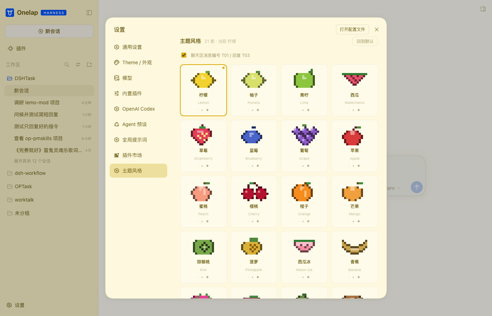
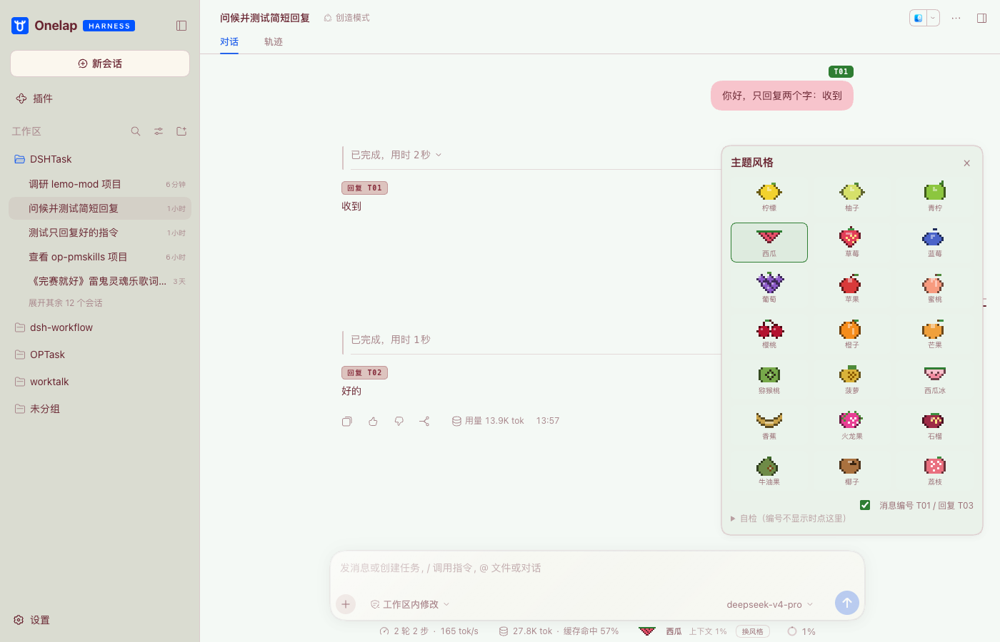

# dsh-pixel-themes

给 **DeepSeek Harness Web GUI** 用的 **21 套水果主题**：配色 + 自绘像素水果小画。


| 设置 → 主题风格 | 西瓜主题 |
|---|---|
|  |  |

---

## 它做了什么

1. **21 套水果主题**：柠檬、柚子、青柠、西瓜、西瓜冰、草莓、蓝莓、葡萄、苹果、蜜桃、樱桃、
   橙子、芒果、猕猴桃、菠萝、火龙果、石榴、牛油果、椰子、香蕉、荔枝
2. **两个换肤入口**：设置 → **主题风格**（整页画廊）；会话里也可以用输入框上方横条的「换风格」
   直接弹浮层
3. **整套语义配色**：每套主题的 15 色色板推导成 ~55 个 `--dsw-alias-*` token
   （底色/浮层/文字阶梯/边框/品牌色/按钮/气泡/代码块/滚动条/提示条），亮/暗两套值自动跟随 DSH 明暗设置
4. **聊天区消息编号**：`T01` / `T02` + 助手回复抬头「回复 T01」，可在浮层里一键关掉
5. **工具行/过程行外观**：过程区左侧主题色竖线（hover 变色）、等宽数字
6. **悬停细节**：编号徽章抬起、用户消息底色、装饰字符淡入；带 `prefers-reduced-motion` 降级
7. **选择记在本机** `localStorage`，重启还在

## 安装

### 桌面 App（Electron）

桌面端的 profile 被应用独占，`dsh plugin` 不能写。用它的用户 patch 层按路径挂载：

```yaml
# ~/.dsh/profiles/desktop/cordis.patch.yml 末尾
- insert:
    - id: pixel-themes
      name: 'file:///Users/<you>/Documents/FlY/StyleDSH/pixel-themes/index.js'
```

**退出并重开桌面 App** 生效（插件只在启动时装载）。

### CLI / web profile

```sh
dsh plugin --profile web add /path/to/pixel-themes
# 或者打包后：dsh plugin --profile web add ./dsh-pixel-themes-1.1.0.tgz
```

装完重启该 profile 的服务，设置 → 主题风格 即可换。

### 卸载

```sh
dsh plugin --profile web remove dsh-pixel-themes
# 桌面端：删掉 cordis.patch.yml 里那三行
```

## 自己加/改主题

```
data/styles.json        ← 21 套主题数据（id / name / 15 色 / bubbles / sprite）
src/client.template.js  ← 全部逻辑（token 推导、浮层、编号、横条、CSS）
scripts/build.mjs       ← 把数据填进模板，生成 client.js（无需 bundler）
client.js               ← 产物，DSH 直接加载
```

```sh
node scripts/build.mjs                    # 用 data/styles.json 重新生成 client.js
node scripts/build.mjs other-styles.json  # 换一份数据
```

- 一套主题最少只要：`id`、`name{zh,en}`、15 个颜色、可选的 `bubbles` 与 `sprite`
- 没有 `sprite` 的主题会显示一块「Aa」色块（可作为纯色主题）
- 改配色推导逻辑：`deriveTokens()`（纯函数，风格包 → token 表）

## 实现要点（踩过的坑）

1. **手写 bundle，不用构建链**：DSH 客户端 bundle 的契约是
   `window.__ModuleLoader__.load({ id, factory: (require) => exports })`，导出 `{ name, inject, apply }`
   就是 cordis 客户端插件；CSS 直接注入 `<style>`。
2. **必须用 `!important` 变量表**：正规路径是 `ctx.theme.overrideTokens()`，但别的皮肤插件（如 dream-skin）
   会直接往 body 写行内变量把整层吃掉；所以本包同时写一张
   `body:not([data-ds-dark-theme]) / body[data-ds-dark-theme]` 的 `!important` 样式表，既跟随明暗又压得住。
3. **聊天行选择器要用后代匹配**：0.2.0 里行是 `[data-chat-flow]` 的直接子元素，0.2.1 里被包进
   `[data-slot="conversation.chat.flow"]`，用 `>` 会一个都匹配不到。
4. **消息编号用 CSS 计数器**：`conversation.chat.node` 是 keyed 槽且已被内置占位，
   拿不到消息行渲染权，所以用 `counter-reset/increment` + `::before` 做 T01 与「回复 T0x」。
5. **theme 服务可选**：`ctx.theme` 缺失时样式表路径仍然有效（不依赖主题服务）。

## 许可

MIT（`LICENSE`）。配色与像素画为原创，不含第三方素材；商标与免责说明见 [NOTICE.md](NOTICE.md)。
